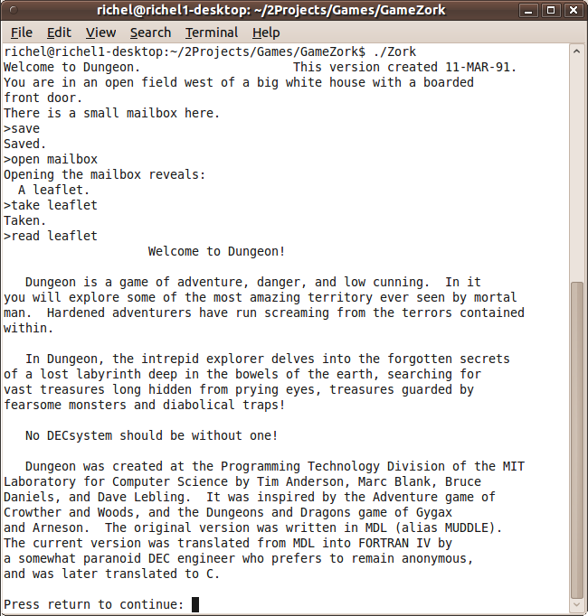

# Zork

Zork is one of [Richèl Bilderbeek's games](https://richelbilderbeek.github.io/games/).

A game by Tim Anderson, Marc Blank, Dave Lebling and Bruce Daniels, that I ported to Qt Creator.

This is the game 'dungeon' as implemented in C, based on the version distributed on a DECUS tape, circa 1980.

## Screenshots

## Links

- [Source code](https://github.com/richelbilderbeek/Zork)
